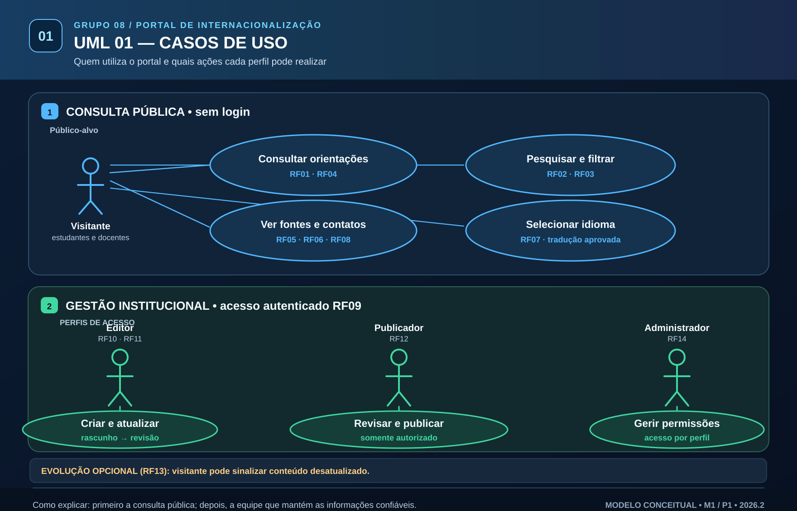
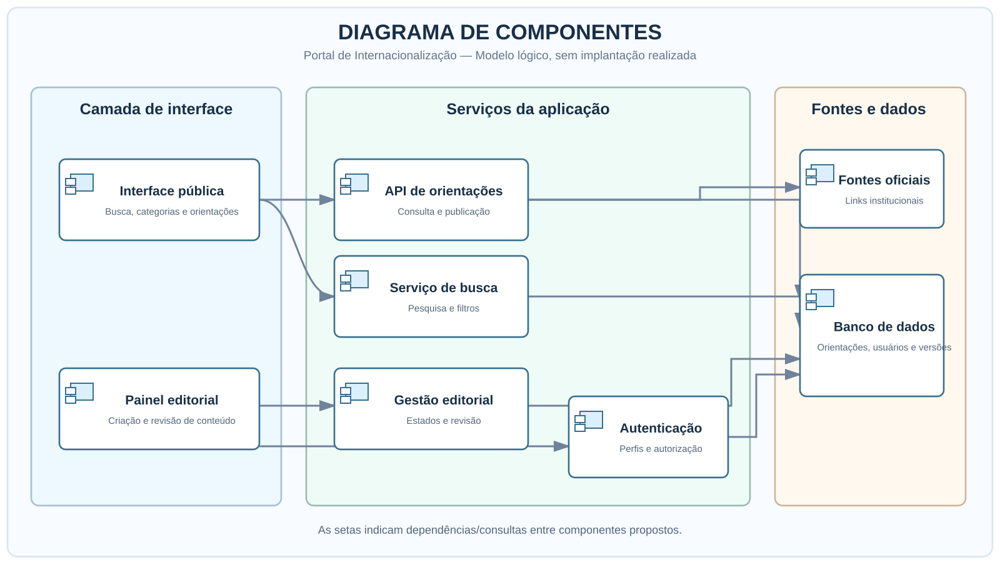
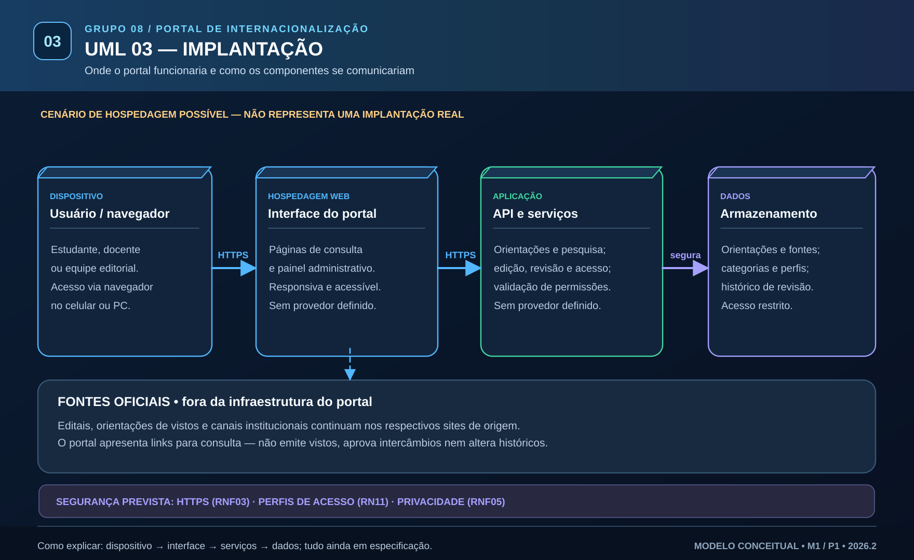

# 🌍 Portal de Internacionalização | UNIFOR — Grupo 08

**Disciplina:** Requisitos e Modelagem de Sistemas · **Semestre:** 2026.2 · **Proposta 4**  
**Atividade:** P1 — Elicitação e Modelagem Inicial · **Milestone M1:** 20/10 a 02/11/2026  
**Equipe:** Ruan Levi Ferreira Macedo · Lorhan Dejan Ferreira Macedo · Hiago Queiroz Barreto

> **Problema:** Como melhorar a experiência de estudantes e docentes na busca por informações e serviços de internacionalização?

Propomos um **portal web informativo** que facilite encontrar orientações sobre intercâmbio, dupla titulação, vistos, documentação, aproveitamento de disciplinas, despesas, hospedagem e contatos. **Acessibilidade, organização da informação, versões multilíngues e governança de conteúdo** são pontos centrais da Proposta 4. **Não existe implementação do portal nesta entrega P1**; o trabalho trata de requisitos e modelagem.

## 📚 Entregáveis da P1

| Item exigido | Arquivo do Grupo 08 | Situação |
|---|---|---|
| 1. Documento de Visão | [Visão da demanda](Requisitos/Elicitacao/01-documento-de-visao.md) | Elaborado; a validar |
| 2. Stakeholders | [Partes interessadas](Requisitos/Elicitacao/02-stakeholders.md) | Mapeamento inicial |
| 3. Roteiro e resultados de entrevistas | [Roteiros e análise documental](Requisitos/Elicitacao/03-roteiros-e-resultados.md) · [Persona e entrevista simulada](Requisitos/Elicitacao/04-persona-e-entrevista-simulada.md) | **Entrevista real pendente** |
| 4. Requisitos RF/RNF | [Especificação inicial](Requisitos/Especificacao/01-requisitos-funcionais-e-nao-funcionais.md) | Elaborada |
| 5. Regras de negócio | [RN01–RN11](Requisitos/Especificacao/02-regras-de-negocio.md) | Propostas |
| 6. Backlog priorizado | [US01–US12](Requisitos/Especificacao/03-backlog-priorizado.md) | MoSCoW |
| 7. UML Casos de Uso | [Visual](diagrams/01-casos-de-uso.svg) · [Fonte](diagrams/01-casos-de-uso.puml) | Publicado |
| 8. UML Componentes | [Visual](diagrams/02-componentes.svg) · [Fonte](diagrams/02-componentes.puml) | Publicado |
| 9. UML Implantação | [Visual](diagrams/03-implantacao.svg) · [Fonte](diagrams/03-implantacao.puml) | Publicado |

**Complementos:** [SRS preliminar](Requisitos/Especificacao/04-SRS-preliminar.md) · [Glossário do domínio](Requisitos/Especificacao/05-glossario.md) · [Fontes e decisões](GestaoConfiguracao/02-fontes-e-decisoes.md).

**Elicitação:** a entrevista com Lívia é uma **simulação de persona**, não uma pesquisa realizada com participante real. Os **achados documentais (AD)** são distintos das **hipóteses simuladas (SIM)**.

## 🗂️ Organização inspirada no repositório LAPIS

```text
README.md
Requisitos/
  README.md
  Elicitacao/       → Visão, stakeholders, roteiros e persona
  Especificacao/    → RF/RNF, RN, backlog, SRS e glossário
  Artefatos/        → Referência aos templates do professor
GestaoConfiguracao/ → Entrega P1, fontes, gestão de mudanças e sprints
diagrams/           → Casos de Uso, Componentes e Implantação (SVG + PlantUML)
evidencias/         → Registros e imagem do convite ao professor
.github/            → Modelo de Pull Request para evoluções futuras
```

Seguindo o [LAPIS do professor](https://github.com/marcelobezerra-dotcom/Lapis-unifor), o trabalho é organizado segundo **Análise de Viabilidade → Elicitação → Especificação → Validação**. Na P1, a elaboração inicial está documentada; **a validação com interessados ainda depende de contato real**.

[Índice de Requisitos](Requisitos/README.md) · [Gestão de Configuração](GestaoConfiguracao/README.md) · [Guia UML](diagrams/README.md) · [Evidências](evidencias/LEIA-ME.md)

### Visualizar os diagramas

<details><summary><strong>Casos de Uso</strong></summary>



</details>
<details><summary><strong>Componentes</strong></summary>



</details>
<details><summary><strong>Implantação</strong></summary>



</details>

## 🗓️ Sprints, issues e próximos passos

- **[Issues #1–#10](https://github.com/Ruan-levi/-requisitos-20262--grupo08/issues):** #1–#2 e #4–#9 concluídas; **#3** (entrevista real) e **#10** (evidência/AVA) abertas.
- **[Milestones](https://github.com/Ruan-levi/-requisitos-20262--grupo08/milestones):** M1 criada para a entrega inicial; conferir issues atribuídas.
- **[GitHub Projects e Kanban](GestaoConfiguracao/04-guia-github-projects.md):** instruções para criar o quadro de acompanhamento indicado no LAPIS.
- **Próximas atividades:** refinar SRS, casos de uso, controle de versões e possíveis protótipos **conforme os enunciados futuros**; não presumir novas exigências.

## ✅ Antes de enviar no AVA

- [x] Visão, stakeholders, RF/RNF, regras, backlog, diagramas e análise documental publicados.
- [x] Convite ao usuário **`marcelobezerra-dotcom`** registrado em [evidência visual](evidencias/registro-convite-professor.md); captura anterior mostrava **Pending Invite**.
- [ ] Registrar resultados de **entrevista efetivamente realizada** para atender integralmente ao item.
- [ ] Confirmar que o professor **aceitou** o convite em `Settings → Collaborators`.
- [ ] Verificar se todas as issues constam na M1 e, se necessário, configurar o **Project/Kanban**.
- [ ] Conferir o nome do repositório: possui hífen inicial extra (`-requisitos-20262--grupo08`), enquanto a P1 indica `requisitos-20262--grupo08`.
- [ ] **Enviar o link do GitHub e a comprovação solicitada no AVA**.

**Critérios informados:** Visão 0,5 · Elicitação 0,5 · Requisitos 0,5 · UML 0,5 = **2,0 pontos possíveis**.

**Referência de organização:** [LAPIS — Marcelo Bezerra](https://github.com/marcelobezerra-dotcom/Lapis-unifor). *Projeto acadêmico; não representa sistema oficial ou já implantado da UNIFOR.*
