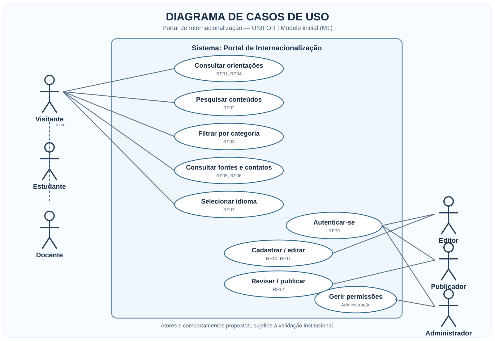
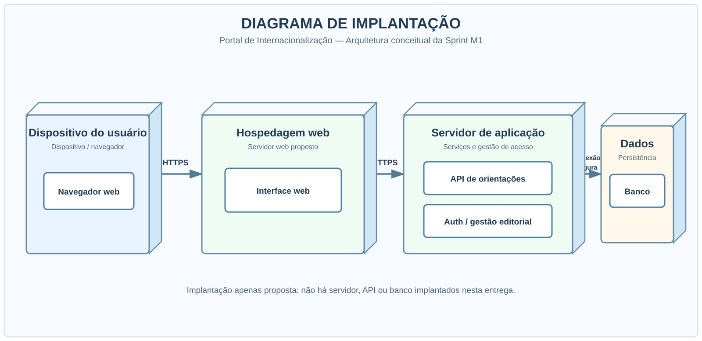

# Portal de Internacionalização | UNIFOR

**Trabalho P1 — Elicitação de Requisitos e Modelagem Inicial**  
**Disciplina:** Requisitos e Modelagem de Sistemas · **Semestre:** 2026.2 · **Equipe:** Grupo 08  
**Tema selecionado:** 4 — Portal de Internacionalização · **Sprint 1 / M1:** 20/10 a 02/11/2026  
**Etapa do projeto:** análise e modelagem, **sem implementação obrigatória nesta entrega**.

---

## 1. Contexto e problema

A proposta parte da seguinte questão definida nos materiais da disciplina:

> **Como melhorar a experiência de estudantes e docentes na busca por informações e serviços de internacionalização?**

O projeto investiga formas de facilitar a localização, a compreensão e a atualização de orientações sobre **intercâmbio, dupla titulação, vistos, documentação, aproveitamento de disciplinas, despesas, hospedagem, contatos e serviços institucionais**.

A análise também contempla as quatro preocupações destacadas no **Tema 4**: **acessibilidade**, **organização da informação**, **versões multilíngues** e **governança do conteúdo**.

**Importante:** a proposta não presume que a UNIFOR não possua informações de internacionalização. O problema a validar é a *experiência de consulta* a essas informações.

## 2. Visão e objetivos da solução

O **Portal de Internacionalização** é uma proposta de **sistema web informativo**, com uma área pública de consulta e uma área de gestão destinada a responsáveis autorizados.

**Objetivo geral:** especificar uma solução que facilite a busca e o entendimento de informações e serviços de internacionalização acadêmica.

**Objetivos específicos:**

- Centralizar orientações e organizar os conteúdos por assunto e público-alvo.
- Permitir pesquisas por palavra-chave e filtragem por categorias.
- Direcionar o usuário para documentos, contatos e fontes institucionais.
- Considerar navegação acessível, responsiva e informações em mais de um idioma.
- Definir regras para atualização, revisão e publicação de conteúdos.

### Público-alvo e partes interessadas

| Público / stakeholder | Necessidade investigada |
|---|---|
| **Estudantes** | Encontrar orientações sobre mobilidade, documentação e preparação. |
| **Docentes** | Localizar serviços e informações sobre atividades acadêmicas internacionais. |
| **Estudantes internacionais** | Compreender orientações com linguagem acessível e suporte multilíngue. |
| **Equipe de internacionalização** | Validar fontes e organizar revisão, manutenção e publicação. |
| **Coordenações de curso** | Apoiar encaminhamentos acadêmicos pertinentes. |
| **Equipe de TI** | Apoiar questões de segurança, privacidade, acesso e manutenção. |

**Nomenclatura institucional:** o documento do Tema 4 menciona **DRI**, enquanto o material de extensão utiliza **NEI**. A denominação vigente e as respectivas competências precisam ser confirmadas; o projeto não assume equivalência entre as duas unidades.

## 3. Escopo do produto proposto

| Incluído na proposta inicial | Fora do escopo inicial |
|---|---|
| Catálogo de orientações por tema e público | Inscrição oficial em programas de mobilidade |
| Busca por palavra-chave e filtros | Aprovação automática de candidaturas |
| Informações e links para fontes oficiais | Emissão de vistos e documentos oficiais |
| Contatos e canais de atendimento | Processamento de pagamentos |
| Identificação da fonte e da última revisão | Alteração de matrículas ou histórico acadêmico |
| Área restrita para gestão editorial | Integrações com sistemas institucionais sem autorização |

**Evoluções consideradas:** versão em inglês dos conteúdos aprovados e recurso de comunicação de informações desatualizadas.

O projeto documenta a **proposta e os requisitos**, não um portal já desenvolvido ou implantado.

---

## 4. Entregáveis obrigatórios da Atividade P1

O enunciado solicita **Documento de Visão, Stakeholders, roteiro e resultados de entrevistas, requisitos funcionais e não funcionais, regras de negócio, backlog priorizado e três diagramas UML**.

| Nº | Entregável | Arquivo disponível | Situação |
|:--:|---|---|---|
| 01 | **Documento de Visão** | [Ler documento](documentos/01-documento-de-visao.md) | Redigido; validação institucional pendente |
| 02 | **Identificação de Stakeholders** | [Ler documento](documentos/02-stakeholders.md) | Mapeamento preliminar |
| 03 | **Roteiro e resultados da elicitação** | [Ler documento](documentos/03-elicitacao-entrevistas.md) | Roteiros e **resultados documentais**; entrevistas reais não comprovadas |
| 04 | **Requisitos Funcionais e Não Funcionais** | [Ler especificação](documentos/04-requisitos.md) | Especificação inicial |
| 05 | **Regras de Negócio** | [Ler regras](documentos/05-regras-de-negocio.md) | Regras propostas |
| 06 | **Backlog Priorizado** | [Ler backlog](documentos/06-backlog-priorizado.md) | Histórias de usuário priorizadas |
| 07 | **UML — Casos de Uso** | [Ver diagrama](diagramas/01-casos-de-uso.svg) · [Editar](diagramas/01-casos-de-uso.puml) | Publicado |
| 08 | **UML — Componentes** | [Ver diagrama](diagramas/02-componentes.svg) · [Editar](diagramas/02-componentes.puml) | Publicado |
| 09 | **UML — Implantação** | [Ver diagrama](diagramas/03-implantacao.svg) · [Editar](diagramas/03-implantacao.puml) | Publicado |

**Material complementar:** [Fontes consultadas, premissas e decisões de escopo](documentos/07-fontes-e-decisoes.md).  
**Convenções dos diagramas:** [Leia-me da pasta UML](diagramas/LEIA-ME.md).

### 4.1. Diagramas UML — visualização

Os arquivos **SVG** podem ser visualizados no GitHub. As fontes **PlantUML (`.puml`)** ficam disponíveis para alterações futuras.

<details>
<summary><strong>Diagrama de Casos de Uso — atores e funcionalidades</strong></summary>



</details>

<details>
<summary><strong>Diagrama de Componentes — divisão lógica do portal</strong></summary>


</details>

<details>
<summary><strong>Diagrama de Implantação — arquitetura proposta</strong></summary>



</details>

---

## 5. Metodologia de elicitação e rastreabilidade

A primeira etapa do projeto foi organizada em **análise documental, identificação dos interessados, preparação de entrevistas, definição de requisitos, priorização e modelagem UML**.

**Fontes documentais da disciplina:**

1. *Propostas de Projetos de Sistemas — Internacionalização e ENADE* (UNIFOR, 2026.2), com foco no **Tema 4 — Portal de Internacionalização**, p. 2.
2. *Projeto de Extensão — Internacionalização: Engenharia de Requisitos Aplicada ao Contexto Educacional* (UNIFOR), apresentação de apoio sobre contexto, stakeholders e técnicas de elicitação.
3. Enunciado da **Atividade 1 — Trabalho P1 (2,0 pontos)**, incluindo os entregáveis e critérios de avaliação.

### 5.1. Resultados efetivamente obtidos

A documentação registra **achados da leitura dos materiais** e os relaciona aos requisitos. Por exemplo:

| Evidência documental | Decisão de especificação | Histórias do backlog |
|---|---|---|
| Necessidade de facilitar a busca por orientações | **RF01–RF03:** categorias, pesquisa e filtros | **US01–US03** |
| Temas de internacionalização previstos na proposta | **RF04–RF06:** orientações, fontes e contatos | **US04–US05** |
| Acessibilidade e idiomas como questões de levantamento | **RNF01–RNF02**, **RF07** | **US09** |
| Governança e atualização de informações | **RF08–RF12**, **RNF07–RNF08** | **US06–US08**, **US10** |

Os códigos são detalhados nos arquivos de [elicitação](documentos/03-elicitacao-entrevistas.md), [requisitos](documentos/04-requisitos.md) e [backlog](documentos/06-backlog-priorizado.md).

### 5.2. Limitações e validações pendentes

> **As entrevistas reais não foram comprovadas neste repositório.** O entregável de elicitação apresenta roteiros para estudantes, docentes e responsáveis institucionais, além dos **resultados da análise documental**. Não contém falas atribuídas a participantes fictícios.

Também permanecem pendentes a confirmação de responsáveis institucionais e a validação dos requisitos propostos. O material da UNIFOR especifica que as descrições dos temas **não constituem requisitos já validados**.

---

## 6. Priorização e gestão da Sprint M1

A priorização do **backlog do produto** segue a abordagem **MoSCoW**: **Must Have** (essencial), **Should Have** (importante) e **Could Have** (desejável). A Sprint M1 é dedicada **à análise e à modelagem inicial**, e não à implementação das funcionalidades.

Foram cadastradas **10 issues** para acompanhar os entregáveis. Os números abaixo apontam para as tarefas reais no GitHub.

| Issue | Atividade | Registro de acompanhamento |
|---|---|---|
| [#1](https://github.com/Ruan-levi/-requisitos-20262--grupo08/issues/1) | Documento de Visão | Documento publicado |
| [#2](https://github.com/Ruan-levi/-requisitos-20262--grupo08/issues/2) | Stakeholders | Mapeamento publicado |
| [#3](https://github.com/Ruan-levi/-requisitos-20262--grupo08/issues/3) | Elicitação | **Aberta:** aguarda entrevistas reais, se realizadas |
| [#4](https://github.com/Ruan-levi/-requisitos-20262--grupo08/issues/4) | Requisitos | Especificação publicada |
| [#5](https://github.com/Ruan-levi/-requisitos-20262--grupo08/issues/5) | Regras de Negócio | Documento publicado |
| [#6](https://github.com/Ruan-levi/-requisitos-20262--grupo08/issues/6) | Backlog Priorizado | Backlog publicado |
| [#7](https://github.com/Ruan-levi/-requisitos-20262--grupo08/issues/7) | Diagrama de Casos de Uso | Modelo publicado |
| [#8](https://github.com/Ruan-levi/-requisitos-20262--grupo08/issues/8) | Diagrama de Componentes | Modelo publicado |
| [#9](https://github.com/Ruan-levi/-requisitos-20262--grupo08/issues/9) | Diagrama de Implantação | Modelo publicado |
| [#10](https://github.com/Ruan-levi/-requisitos-20262--grupo08/issues/10) | Evidência do professor e submissão | **Aberta:** ações externas pendentes |

**Milestone M1:** a criação da milestone e a vinculação das issues **ainda precisam ser confirmadas no GitHub**. Os títulos das issues indicam M1, mas isso **não equivale** à associação efetiva a uma milestone.

[Acessar as issues](https://github.com/Ruan-levi/-requisitos-20262--grupo08/issues) · [Acessar as milestones](https://github.com/Ruan-levi/-requisitos-20262--grupo08/milestones)

## 7. Critérios de avaliação da P1

| Critério informado no enunciado | Valor | Evidências no repositório |
|---|---:|---|
| Clareza da visão do problema | **0,5** | Documento de Visão |
| Qualidade da elicitação | **0,5** | Stakeholders, roteiros e análise documental (**entrevistas reais pendentes**) |
| Qualidade dos requisitos | **0,5** | RF, RNF, regras de negócio e backlog |
| Modelagem UML | **0,5** | Casos de Uso, Componentes e Implantação |
| **Total possível** | **2,0** | Documentação e modelos apresentados |

A tabela representa **critérios do professor**, não nota recebida ou garantia de pontuação.

---

## 8. Estrutura do repositório

```text
-requisitos-20262--grupo08/
├── README.md
├── documentos/
│   ├── 00-orientacoes-da-entrega.md
│   ├── 01-documento-de-visao.md
│   ├── 02-stakeholders.md
│   ├── 03-elicitacao-entrevistas.md
│   ├── 04-requisitos.md
│   ├── 05-regras-de-negocio.md
│   ├── 06-backlog-priorizado.md
│   └── 07-fontes-e-decisoes.md
├── diagramas/
│   ├── LEIA-ME.md
│   ├── 01-casos-de-uso.puml
│   ├── 01-casos-de-uso.svg
│   ├── 02-componentes.puml
│   ├── 02-componentes.svg
│   ├── 03-implantacao.puml
│   └── 03-implantacao.svg
└── evidencias/
    └── LEIA-ME.md
```

## 9. Evidências e entrega no AVA

A atividade solicita: **(a) link deste repositório** e **(b) comprovação de que o usuário `marcelobezerra-dotcom` foi adicionado ao GitHub**.

**Pendências verificáveis antes da submissão:**

- [x] Documentos de visão, interessados, requisitos, regras e backlog publicados.
- [x] Roteiro e resultados de **análise documental** publicados.
- [x] Três diagramas UML em formato visual e editável publicados.
- [x] Issues correspondentes aos entregáveis criadas no GitHub.
- [ ] Registrar entrevistas reais, caso tenham sido realizadas pelo grupo.
- [ ] Criar/confirmar **Milestone M1** e vincular as issues a ela.
- [ ] Confirmar o convite ou a associação do usuário **`marcelobezerra-dotcom`** ao repositório.
- [ ] Publicar captura **real** do convite/acesso em **`evidencias/convite-professor.png`**.
- [ ] Enviar link do GitHub e evidência no AVA.

[Orientações para a evidência](evidencias/LEIA-ME.md) · [Abrir pasta de evidências](evidencias/)

**Atenção:** o fato de o repositório ser público não comprova a inclusão do professor como colaborador. Não serão utilizados prints ou relatos fictícios.

## 10. Equipe

**Grupo 08 — integrantes:**

- **Ruan Levi Ferreira Macedo**
- **Lorhan Dejan Ferreira Macedo**
- **Hiago Queiroz Barreto**

---

*Projeto acadêmico de análise e modelagem de sistemas. Não representa uma plataforma oficial da UNIFOR nem uma implantação em produção.*
