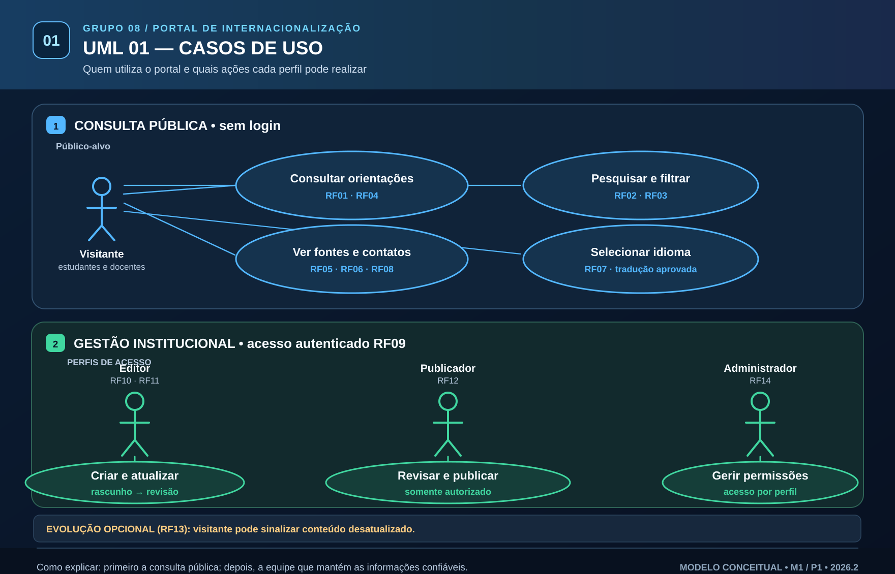
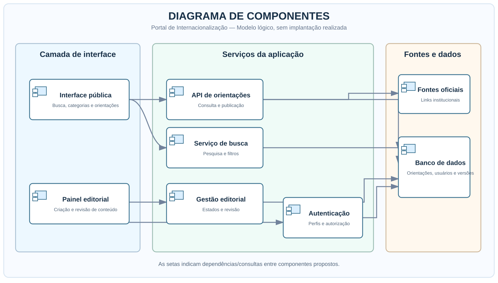
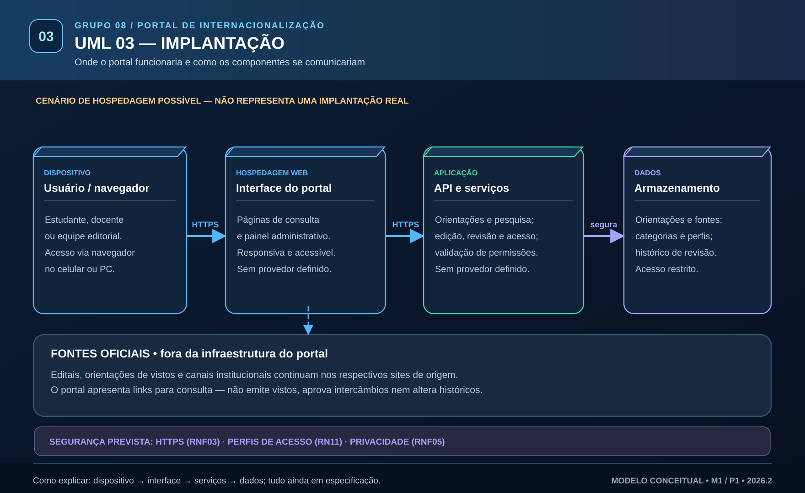

# 🌍 Portal de Internacionalização | UNIFOR — Grupo 08

**Disciplina:** Requisitos e Modelagem de Sistemas · **Semestre:** 2026.2 · **Proposta 4**  
**Atividade:** P1 — Elicitação e Modelagem Inicial · **Milestone M1:** 20/10 a 02/11/2026  
**Equipe:** Ruan Levi Ferreira Macedo · Lorhan Dejan Ferreira Macedo · Hiago Queiroz Barreto

> **Problema:** Como melhorar a experiência de estudantes e docentes na busca por informações e serviços de internacionalização?

Propomos um **portal web informativo** que facilite encontrar orientações sobre intercâmbio, dupla titulação, vistos, documentação, aproveitamento de disciplinas, despesas, hospedagem e contatos. **Acessibilidade, organização da informação, versões multilíngues e governança de conteúdo** são pontos centrais da Proposta 4. **A P1 exigia documentação e modelagem, não implementação.** Posteriormente o grupo desenvolveu um protótipo web complementar, com fluxos públicos demonstrativos, sem autenticação ou backend.

## 📚 Entregáveis da P1

| Item exigido | Arquivo do Grupo 08 | Situação |
|---|---|---|
| 1. Documento de Visão | [Visão da demanda](Requisitos/Elicitacao/01-documento-de-visao.md) | Elaborado; a validar |
| 2. Stakeholders | [Partes interessadas](Requisitos/Elicitacao/02-stakeholders.md) | Mapeamento inicial |
| 3. Roteiro e resultados de entrevistas | [Roteiros e análise documental](Requisitos/Elicitacao/03-roteiros-e-resultados.md) · [Persona e entrevista simulada](Requisitos/Elicitacao/04-persona-e-entrevista-simulada.md) | **Entrevista real pendente** |
| 4. Requisitos RF/RNF | [Especificação inicial](Requisitos/Especificacao/01-requisitos-funcionais-e-nao-funcionais.md) | Elaborada |
| 5. Regras de negócio | [RN01–RN11](Requisitos/Especificacao/02-regras-de-negocio.md) | Propostas |
| 6. Backlog priorizado | [US01–US12](Requisitos/Especificacao/03-backlog-priorizado.md) | MoSCoW |
| 7. UML Casos de Uso | [Visual](diagrams/01-casos-de-uso.svg) · [Fonte](diagrams/01-casos-de-uso.puml) | Publicado |
| 8. UML Componentes | [Visual](diagrams/02-componentes.svg) · [Fonte](diagrams/02-componentes.puml) | Publicado |
| 9. UML Implantação | [Visual](diagrams/03-implantacao.svg) · [Fonte](diagrams/03-implantacao.puml) | Publicado |

**Complementos:** [Necessidades dos usuários e justificativa do portal](Requisitos/Elicitacao/05-necessidades-dos-usuarios.md) · [SRS preliminar](Requisitos/Especificacao/04-SRS-preliminar.md) · [Glossário do domínio](Requisitos/Especificacao/05-glossario.md) · [Fontes e decisões](GestaoConfiguracao/02-fontes-e-decisoes.md).

**Elicitação:** a entrevista com Lívia é uma **simulação de persona**, não uma pesquisa realizada com participante real. Os **achados documentais (AD)** são distintos das **hipóteses simuladas (SIM)**.

## 🗂️ Organização inspirada no repositório LAPIS

```text
README.md
Requisitos/
  README.md
  Elicitacao/       → Visão, stakeholders, roteiros e persona
  Especificacao/    → RF/RNF, RN, backlog, SRS e glossário
  Artefatos/        → Referência aos templates do professor
GestaoConfiguracao/ → Entrega P1, fontes, gestão de mudanças e sprints
diagrams/           → Casos de Uso, Componentes e Implantação (SVG + PlantUML)
evidencias/         → Registros e imagem do convite ao professor
.github/            → Modelo de Pull Request para evoluções futuras
```

Seguindo o [LAPIS do professor](https://github.com/marcelobezerra-dotcom/Lapis-unifor), o trabalho é organizado segundo **Análise de Viabilidade → Elicitação → Especificação → Validação**. Na P1, a elaboração inicial está documentada; **a validação com interessados ainda depende de contato real**.

[Índice de Requisitos](Requisitos/README.md) · [Gestão de Configuração](GestaoConfiguracao/README.md) · [Guia UML](diagrams/README.md) · [Evidências](evidencias/LEIA-ME.md)

### 🎤 Diagramas renovados para apresentação

**[Abrir o roteiro de apresentação dos três diagramas](diagrams/GUIA-APRESENTACAO.md)** — traz falas sugeridas, requisitos correspondentes e um exemplo que conecta os três desenhos. Os SVG foram refeitos para visualização em tela cheia e em projetor, com fontes maiores, legenda visual e organização por finalidade. O PlantUML permanece editável.

### Visualizar os diagramas

<details><summary><strong>Casos de Uso</strong></summary>



</details>
<details><summary><strong>Componentes</strong></summary>



</details>
<details><summary><strong>Implantação</strong></summary>



</details>

## 🗓️ Sprints, issues e próximos passos

**Auditoria para apresentação em 26/11/2026:** [análise dos requisitos, limitações, testes e roteiro de demonstração](GestaoConfiguracao/05-auditoria-apresentacao-2026-11-26.md).

- **[Issues #1–#10](https://github.com/Ruan-levi/-requisitos-20262--grupo08/issues):** #1–#2 e #4–#9 concluídas; **#3** (entrevista real) e **#10** (evidência/AVA) reabertas por ausência de evidências. Issues **#13–#18** rastreiam a próxima etapa.
- **[Milestones](https://github.com/Ruan-levi/-requisitos-20262--grupo08/milestones):** M1 existente com 8 issues concluídas e 2 pendentes. **M2 — Protótipo e validação ainda precisa ser criada no GitHub**; as tarefas de preparação estão na issue #17.
- **[GitHub Projects e Kanban](GestaoConfiguracao/04-guia-github-projects.md):** roteiro atualizado para criar o quadro e relacionar M1/M2; ainda não há confirmação de Project criado.
- **Próximas atividades:** refinar SRS, casos de uso, controle de versões e possíveis protótipos **conforme os enunciados futuros**; não presumir novas exigências.

## ✅ Antes de enviar no AVA

- [x] Visão, stakeholders, RF/RNF, regras, backlog, diagramas e análise documental publicados.
- [x] Convite ao usuário **`marcelobezerra-dotcom`** registrado em [evidência visual](evidencias/registro-convite-professor.md); captura anterior mostrava **Pending Invite**.
- [ ] Registrar resultados de **entrevista efetivamente realizada** para atender integralmente ao item.
- [x] **Acesso do professor confirmado em 25/11/2026:** o GitHub retornou permissão **`write`** para `marcelobezerra-dotcom` (além do registro histórico do convite).
- [x] **Todas as 10 issues foram associadas à Milestone M1** (8 fechadas e 2 abertas).
- [ ] Configurar um **Project/Kanban**, se for solicitado para esta etapa ou utilizado no acompanhamento das próximas atividades.
- [ ] Conferir o nome do repositório: possui hífen inicial extra (`-requisitos-20262--grupo08`), enquanto a P1 indica `requisitos-20262--grupo08`.
- [ ] **Enviar o link do GitHub e a comprovação solicitada no AVA**.

**Critérios informados:** Visão 0,5 · Elicitação 0,5 · Requisitos 0,5 · UML 0,5 = **2,0 pontos possíveis**.

**Referência de organização:** [LAPIS — Marcelo Bezerra](https://github.com/marcelobezerra-dotcom/Lapis-unifor). *Projeto acadêmico; não representa sistema oficial ou já implantado da UNIFOR.*

## 🌐 Protótipo navegável do Portal de Internacionalização

O projeto também possui um **[protótipo interativo em HTML, CSS e JavaScript](prototipo/README.md)**, organizado separadamente na pasta [`prototipo/`](prototipo/).

- **Demonstração:** página inicial e central interna com páginas para programas, instituições e filtros, documentação e checklists, docentes e internacionais, notícias, jornada orientativa, contatos, orientações e fontes contextuais; interface PT/EN, ajuste de texto e fluxo editorial **simulado**.
- **Validação técnica:** `node --test prototipo/tests/*.test.cjs` executa testes de catálogo, rotas, fontes e contatos; a validação visual no navegador ainda precisa de evidência.
- **Actions:** [CI de validação](.github/workflows/validar-prototipo.yml) para PRs/pushes e [deploy com testes como pré-requisito](.github/workflows/publicar-prototipo.yml) para GitHub Pages, publicando apenas `prototipo/`.
- **Limites:** conteúdo didático, sem autenticação, inscrições ou dados reais. O protótipo **não é um serviço institucional da UNIFOR**.
