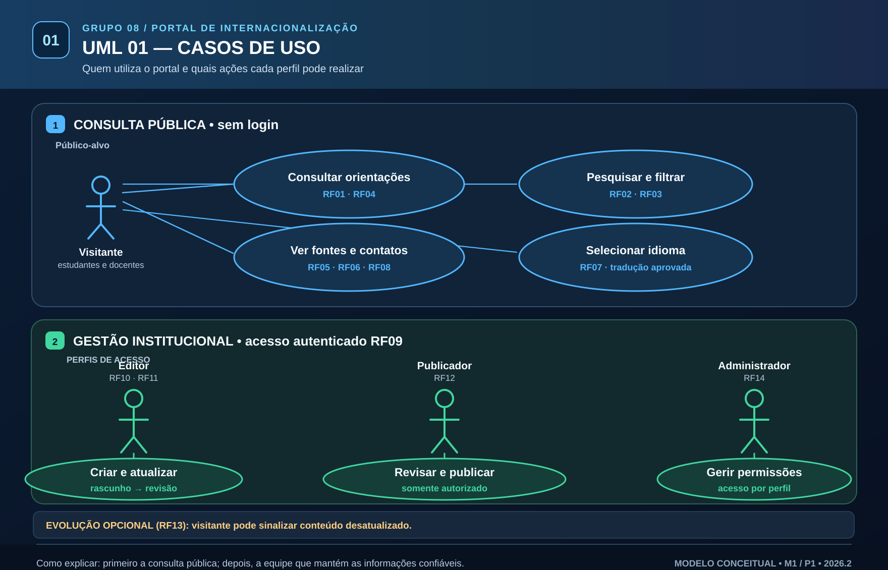
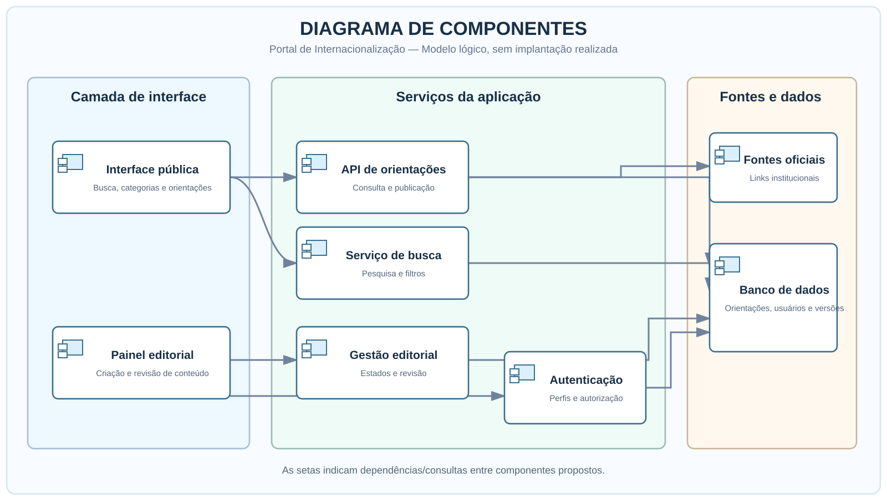
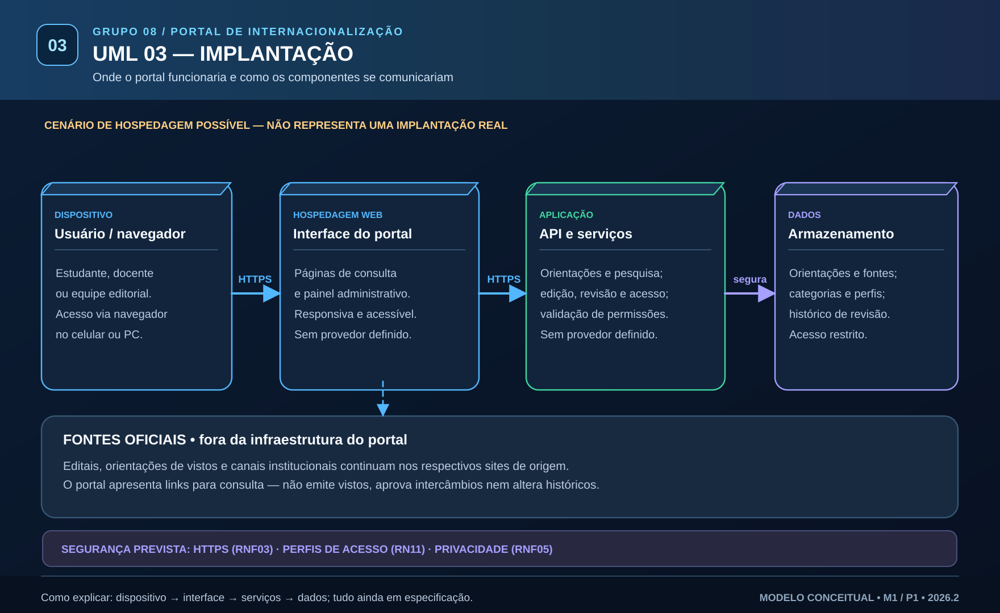

# 🎤 Guia de apresentação dos três diagramas UML

**Grupo 08 — Portal de Internacionalização | Proposta 4 | P1 / M1**

Este roteiro ajuda a explicar **a proposta de sistema**, não uma aplicação já desenvolvida. Os SVG foram desenhados com fonte maior e organização visual para leitura em tela/projetor. Os arquivos `.puml` mantêm os **modelos UML editáveis correspondentes**.

## 1. Casos de Uso — quem usa e o que pode fazer

**Pergunta que ele responde:** *Quem interage com o portal e o que cada pessoa pode realizar?*

**Apresentação sugerida (40–60 segundos):**

> “Dividimos o portal em duas partes. A primeira é pública: estudantes e docentes conseguem procurar informações de intercâmbio e dupla titulação, filtrar conteúdos, acessar documentos e contatos oficiais e visualizar a última revisão. A segunda é administrativa: um editor organiza conteúdos; um publicador confere e aprova; e um administrador controla permissões. O visitante não precisa criar conta. A opção de sinalizar conteúdo desatualizado é uma evolução futura.”

**Requisitos:** consulta RF01–RF08; autenticação e gestão RF09–RF12/RF14; evolução RF13.  
**Atenção:** os papéis editoriais são **propostos**, não confirmados oficialmente pela UNIFOR.

[🔎 Abrir SVG](01-casos-de-uso.svg) · [🛠️ Abrir PlantUML](01-casos-de-uso.puml)

## 2. Componentes — como as partes se relacionam

**Pergunta que ele responde:** *Como o portal seria dividido internamente?*

**Apresentação sugerida (40–60 segundos):**

> “A interface pública envia consultas a serviços de orientações e pesquisa. Esses serviços consultam conteúdos já publicados no banco de dados e exibem as fontes institucionais. Existe também um painel administrativo protegido, que depende de autenticação, permissões e revisão editorial. O editor cadastra um rascunho, o publicador analisa e só então a orientação fica visível ao público. Desse modo, organizamos a governança das informações.”

**Requisitos:** RF01–RF12 e RF14; regras RN01–RN07, RN10–RN11.  
**Atenção:** a divisão é **lógica e conceitual**, sem tecnologias de implementação definidas.

[🔎 Abrir SVG](02-componentes.svg) · [🛠️ Abrir PlantUML](02-componentes.puml)

## 3. Implantação — onde cada parte funcionaria

**Pergunta que ele responde:** *Em quais ambientes o sistema poderia funcionar e como seriam feitas as conexões?*

**Apresentação sugerida (40–60 segundos):**

> “O estudante ou docente acessaria o portal pelo navegador no celular ou computador. A interface web se comunicaria com os serviços da aplicação usando HTTPS. Esses serviços acessariam um banco de dados com conteúdos, categorias, fontes e registros de revisão. A segurança dependeria de acesso restrito, autenticação e proteção dos dados. É uma arquitetura sugerida para o futuro: ainda não escolhemos provedores e não fizemos implantação.”

**Requisitos:** RNF02 (responsividade), RNF03 (segurança), RNF05 (privacidade), RNF08 (manutenibilidade).  
**Atenção:** documentos e contatos oficiais podem ser consultados **por links**; o portal não processa vistos, matrículas nem candidaturas oficiais.

[🔎 Abrir SVG](03-implantacao.svg) · [🛠️ Abrir PlantUML](03-implantacao.puml)

## Exemplo único para conectar os três desenhos

**Situação hipotética:** uma estudante procura orientações sobre *intercâmbio* e *aproveitamento de disciplinas*.

| Etapa explicada | No desenho | Explicação ao professor |
|---|---|---|
| **1. Caso de Uso** | Visitante pesquisa, filtra e abre orientação. | “Mostra a necessidade que o portal atende.” |
| **2. Componente** | Portal público → pesquisa/API → banco. | “Mostra como a função seria organizada tecnicamente.” |
| **3. Implantação** | Navegador → interface → aplicação → dados. | “Mostra em quais ambientes esses componentes poderiam operar.” |
| **Governança** | Editor prepara rascunho → publicador revisa → conteúdo publicado. | “Mostra como manter a informação confiável.” |

**Fechamento sugerido:** “O Grupo 08 entregou a **modelagem de uma solução informativa**. A próxima etapa depende da validação dos requisitos e da evolução do projeto, não de afirmar que a plataforma já existe.”

## Sugestões práticas para mostrar em sala

1. Abra cada arquivo **SVG** no navegador e use a tela cheia (**F11**) para projetar.
2. Mostre na ordem: **Casos de Uso → Componentes → Implantação**.
3. Use os títulos e as cores para orientar o olhar do público: **azul = consulta**, **verde = gestão**, **roxo = dados/infraestrutura**.
4. Se o professor perguntar pelos diagramas editáveis, mostre os arquivos **`.puml`**.

**Fontes do projeto:** [Requisitos](../Requisitos/Especificacao/01-requisitos-funcionais-e-nao-funcionais.md), [Regras de negócio](../Requisitos/Especificacao/02-regras-de-negocio.md), [SRS preliminar](../Requisitos/Especificacao/04-SRS-preliminar.md). **Não** se tratam de requisitos aprovados institucionalmente nem de sistema em produção.
