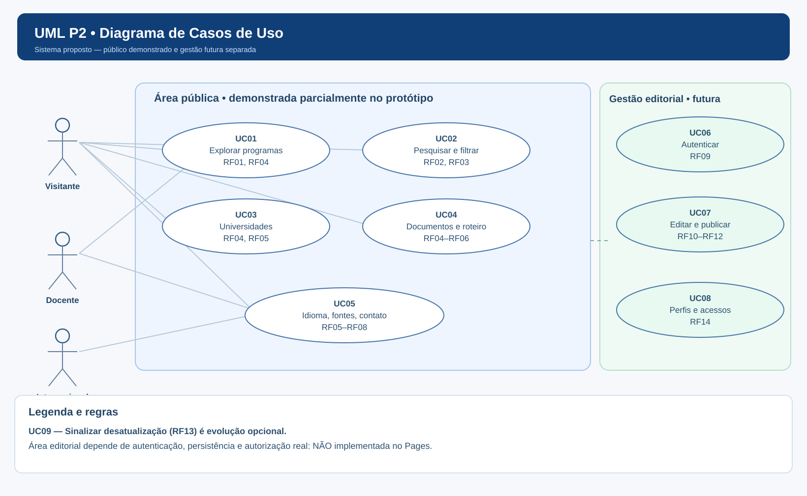
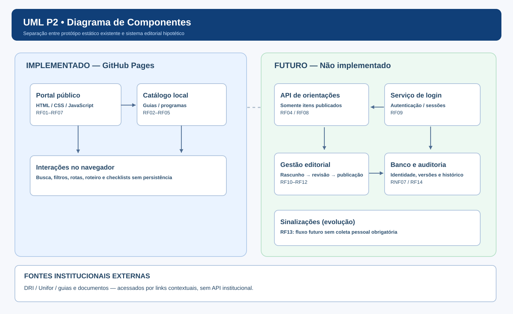
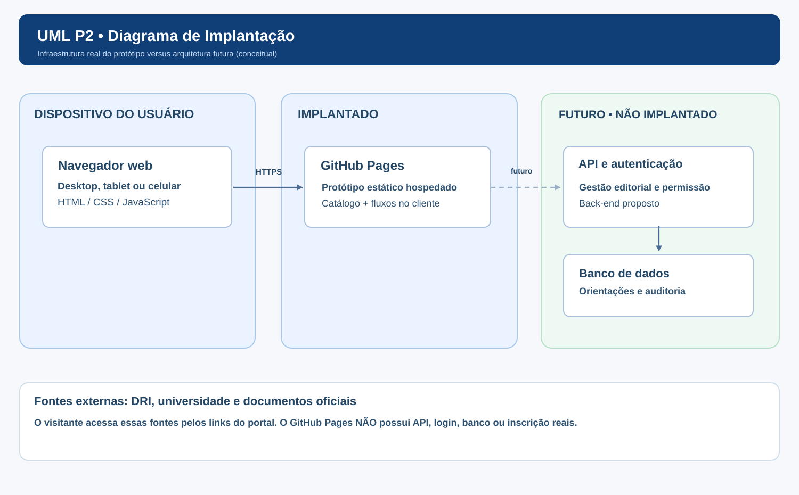

# 📊 Diagramas UML — Portal de Internacionalização

**Grupo 08 · Proposta 4 · Atividades P1 / P2**

## Diagramas atualizados — Trabalho P2 / Milestone M2

Os modelos abaixo foram revisados à luz da [SRS IEEE 830 v2](../Requisitos/Especificacao/06-SRS-IEEE830-P2.md) e da [matriz de consistência](../Requisitos/Especificacao/07-matriz-consistencia-P2.md). Os arquivos antigos da M1 permanecem preservados logo abaixo.

| Modelo P2 | Visual vetorial | Fonte PlantUML |
|---|---|---|
| Casos de uso | [SVG P2](01-casos-de-uso-P2.svg) | [PlantUML P2](01-casos-de-uso-P2.puml) |
| Componentes | [SVG P2](02-componentes-P2.svg) | [PlantUML P2](02-componentes-P2.puml) |
| Implantação | [SVG P2](03-implantacao-P2.svg) | [PlantUML P2](03-implantacao-P2.puml) |

**Nota:** os SVG são **esquemas vetoriais de apresentação** dos mesmos módulos e conceitos, não exportações automáticas 1:1 dos arquivos PlantUML. A fonte formal do diagrama é o arquivo `.puml`. Ambas as representações diferenciam funções públicas de serviços futuros.

---

Os três diagramas exigidos no enunciado foram reorganizados para apresentação: **tipografia grande, legendas curtas, cores consistentes e blocos com finalidade explícita**.

| Modelo exigido | O que apresenta | Visual pronto para apresentar | Fonte UML editável |
|---|---|---|---|
| **Casos de Uso** | **Quem** pode usar cada funcionalidade | [01 — SVG](01-casos-de-uso.svg) | [PlantUML](01-casos-de-uso.puml) |
| **Componentes** | **Quais partes** compõem a solução e se conectam | [02 — SVG](02-componentes.svg) | [PlantUML](02-componentes.puml) |
| **Implantação** | **Onde** a solução funcionaria e como se comunica | [03 — SVG](03-implantacao.svg) | [PlantUML](03-implantacao.puml) |

## 🎤 Apresentação guiada

**[Abrir o GUIA-APRESENTACAO.md](GUIA-APRESENTACAO.md)**: inclui um roteiro de fala de aproximadamente 40–60 segundos por diagrama, perguntas que cada modelo responde e um exemplo único de uso para conectar os três.

### Identidade visual

- **Azul:** experiência pública de estudantes e docentes.
- **Verde:** edição, revisão, autenticação e autorização editorial.
- **Roxo:** armazenamento, referências externas e infraestrutura proposta.

**SVG** = versão vetorial preparada para leitura em projetores e navegadores. **PlantUML (`.puml`)** = especificação UML editável, com a mesma arquitetura e relações fundamentais. O SVG é uma **composição visual de apresentação**, não uma exportação automática 1:1 do PlantUML.

## Modelo acadêmico, não produto pronto

A área pública é informativa; o painel editorial depende de perfis autorizados; fontes oficiais permanecem externas; a infraestrutura de hospedagem **não foi escolhida nem implementada**. Papéis e regras ainda precisam ser validados com a instituição.

### Rastreabilidade

- **Casos de Uso:** RF01–RF12, RF14; RF13 sinalizado como evolução opcional.
- **Componentes:** RF01–RF12, RF14 e RN01–RN11, com foco na gestão de conteúdo.
- **Implantação:** RNF02, RNF03, RNF05 e arquitetura conceitual da SRS.

Os detalhes são desenvolvidos em [RF/RNF](../Requisitos/Especificacao/01-requisitos-funcionais-e-nao-funcionais.md), [Regras de negócio](../Requisitos/Especificacao/02-regras-de-negocio.md) e [SRS](../Requisitos/Especificacao/04-SRS-preliminar.md).

**Editar:** abrir o `.puml` no [PlantUML](https://plantuml.com/pt/), modificar o modelo e **atualizar também o SVG de apresentação** caso as relações ou funções mudem.

[Voltar ao README](../README.md).
